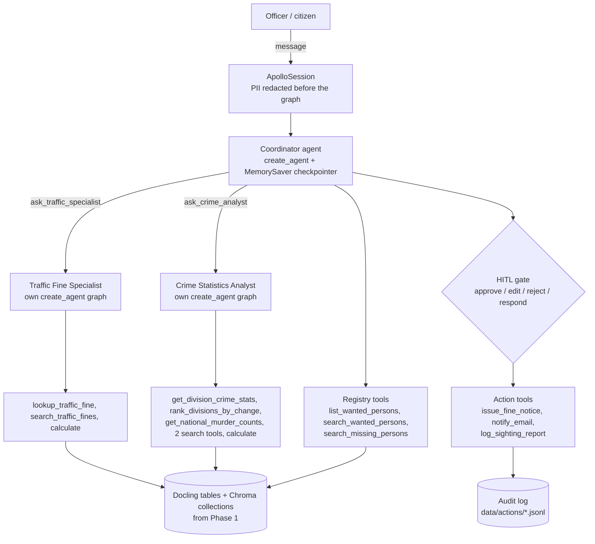

# Phase 2: Agentic architecture

Apollo is a multi-agent system built with LangChain's `create_agent`. A coordinator agent
talks to the user, delegates domain questions to two specialist subagents, and is the only
agent allowed to take high-risk actions, each of which pauses for an officer's review. A
stack of prebuilt middleware handles personal data, failures, runaway loops and long
conversations.

**Result:** all 11 Phase 2 evaluation cases pass against the live model
(`uv run apollo evaluate`; full evidence in [`reports/phase2/evaluation.md`](../../reports/phase2/evaluation.md)).

| Spec requirement | Where it lives | Evidence |
|---|---|---|
| Subagents and context quarantine (8 marks) | `src/apollo/agents/subagents/`, `agents/delegation.py` | 70% of delegated text kept out of the coordinator; 85% on a search-heavy task |
| HITL with checkpointer and multi-decision handler (8 marks) | `src/apollo/middleware/hitl.py`, `agents/session.py` | approve and edit spec cases pass; all four decisions covered by tests |
| Prebuilt middleware stack (9 marks) | `src/apollo/middleware/` | PII, tool-error, retry and limit cases pass live; summarization tested |

## 1. Architecture



### Agents and tools

| Agent | Tools | Can act? | Memory |
|---|---|---|---|
| Coordinator (`apollo_coordinator`) | 2 delegation tools, 3 registry tools, 3 action tools | Yes, through the HITL gate | Checkpointer, one thread per conversation |
| Traffic Fine Specialist | `lookup_traffic_fine`, `search_traffic_fines`, `calculate` | No | None: a fresh context for every task |
| Crime Statistics Analyst | `get_division_crime_stats`, `rank_divisions_by_change`, `get_national_murder_counts`, `search_division_crime_stats`, `search_historical_murders`, `calculate` | No | None: a fresh context for every task |

All three agents run on one Microsoft Foundry deployment, called through LangChain's
`ChatOpenAI` on Foundry's OpenAI-compatible v1 API (`src/apollo/llm.py`), with
`temperature=0` and the client's own retries switched off so that retries are handled,
visibly, by middleware.

### Tool design

The tools separate *finding* information from *stating* it:

- **Search tools** run a semantic search restricted to one PDF (a Chroma `where` filter on
  the chunk's source), so a specialist never sees another domain's text.
- **Exact-lookup tools** read the tables Docling parsed in Phase 1 and return figures
  verbatim: fines and points by section, verified divisional crime figures, national
  murder counts and the wanted-persons registry. Numbers are never left to the model.
- **`calculate`** evaluates arithmetic by walking the parsed expression rather than calling
  `eval()`, so a prompt-injected expression cannot run code.
- **Action tools** are simulated: each appends a record with a reference number
  (FN-, EM-, SR-) to a JSON Lines audit log. `issue_fine_notice` takes the fine from the
  official schedule, never from the model, so a notice cannot carry a wrong amount.
- Tools return text for the model and, separately, citations as an *artifact* the model
  never sees; the UI uses the artifacts for source badges.

## 2. Subagents and context quarantine

The coordinator calls each specialist as a tool. Inside that tool, the specialist runs its
whole agent loop in a fresh message list that contains only the delegated task; only its
final answer is returned to the coordinator (`src/apollo/agents/delegation.py`).
Intermediate tool calls, retrieved chunks and table rows stay inside the specialist and
are discarded.

**Measured effect** (`reports/phase2/evaluation.md`, 8 delegations):

| | Coordinator received | Kept in specialist | Share kept out |
|---|---|---|---|
| All delegations | 4,724 chars | 10,982 chars | 70% |
| Search-heavy task (5 tool calls) | 942 chars | 5,169 chars | 85% |
| Single exact lookup | 219 chars | 312 chars | 59% |

These figures are conservative: the specialists' system prompts and tool schemas, which the
coordinator never carries, are not counted. Quarantine helps most when a specialist does
the most work; for compact exact lookups the saving is modest. A coordinator test checks
the property directly: after a delegated question, the specialist's raw table row is not
anywhere in the coordinator's saved history.

**Trade-off.** A specialist cannot see the conversation, so the coordinator must write a
self-contained task that repeats every section number, division and year. Both
delegation tools' descriptions say so.

**Least privilege.** Specialists only read data. They have no action tools, so every
action passes through the single HITL gate on the coordinator. A test inspects each
specialist's graph to confirm this.

## 3. Human-in-the-loop

`HumanInTheLoopMiddleware` intercepts the model's proposed tool calls. Calls to the three
action tools are not run: the graph pauses with an interrupt listing them, the
`MemorySaver` checkpointer stores the paused state under the conversation's `thread_id`,
and the run resumes only when a reviewer sends one decision per pending call with
`Command(resume={"decisions": [...]})`.

| Decision | Tool runs? | What the model receives |
|---|---|---|
| approve | Yes, as proposed | the tool's result |
| edit | Yes, with the officer's arguments | the result, with a note that a human changed the call |
| reject | No | the officer's reason |
| respond | No | the officer's message in place of the tool's result |

Design decisions:

- **Fail closed.** `interrupt_on` is built from the set of high-risk tool names; if a new
  action tool has no review configuration, the app refuses to start.
- **Batched pausing** (one review per model turn) rather than per-call pausing, so a
  request with a notice and an email can be reviewed together in one panel.
- **`ApolloSession`** (`src/apollo/agents/session.py`) wraps interrupts and resumes in two
  calls, `ask()` and `review()`, and enforces the review rules: no new message while an
  action is pending, exactly one allowed decision per pending action.

Problems found in live testing and fixed:

1. After an *edit*, the model reported the action as failed. The coordinator prompt now
   states what each outcome means (approved and edited actions have been carried out).
2. The model invented placeholder values such as `location: "Unknown"`. Optional
   arguments are now optional in the tool, and the prompt forbids invented values; the
   officer adds missing details by editing.
3. The model once sent the traffic-department email but held back the notice it
   announced. The prompt now forbids notifying about an action that has not run, and
   says to propose dependent actions in order. The fix held over three repeated runs; the
   email now carries the notice's reference number.

## 4. Middleware stack

Defined in one place, `src/apollo/middleware/stack.py`, and pinned by a test. The first
middleware listed is the outermost; before-model hooks run in list order and after-model
hooks in reverse order.

| # | Coordinator middleware | Purpose |
|---|---|---|
| 1-2 | `PIIMiddleware[email]`, `PIIMiddleware[trn]` | Redact emails and Jamaican TRNs before any model call |
| 3 | `SummarizationMiddleware` | Summarize history beyond ~6,000 tokens, keeping the last 12 messages |
| 4 | `ModelCallLimitMiddleware` (10 per run) | Backstop that ends any loop |
| 5 | `ModelRetryMiddleware` (3 retries, ~1s, 2s, 4s) | Exponential backoff on transient model errors |
| 6 | `HumanInTheLoopMiddleware` | Officer review of the three action tools |
| 7-10 | `ToolCallLimitMiddleware` (12 per run; 3 per action tool) | Stop runaway tool use and floods of actions |
| 11 | `ToolErrorMiddleware` | Turn expected tool errors into feedback for the model |
| 12 | `ToolRetryMiddleware` (2 retries, read-only tools only) | Backoff on transient search failures |

Specialists use the same layers except HITL, per-action limits and summarization (they
start fresh for every task), with limits of 8 model calls and 10 tool calls per run.

### What each layer solves

**Tool errors.** Without middleware, `lookup_traffic_fine("invalid_section_code_9999")`
raised a `ValueError` that crashed the whole run. `ToolErrorMiddleware` returns an error
message the model can act on. Handling is deliberately narrow: only errors our tools raise
on purpose (`ValueError`, and `FileNotFoundError` with the path hidden) are shown; any
other exception still propagates, so internal details never reach the model or the user.

**PII.** `PIIMiddleware` has no Jamaican TRN type, so it gets a custom detector
(`\b\d{3}[- ]?\d{3}[- ]?\d{3}\b`), tested not to match phone numbers such as the tip line
876-838-3589, fine amounts or years. Testing showed the middleware alone kept PII away from
the model but not out of the conversation history: the checkpointer saves an incoming
message before any middleware runs, so the first two checkpoints held the raw TRN and
email. `ApolloSession` therefore redacts with the same patterns before the message enters
the graph, and the in-graph middleware remains as defence in depth. The evaluation checks
every checkpoint, not just the latest.

**Retries.** Both retry middlewares retry *every* exception by default, which would retry
an invalid section code or a wrong API key for nothing. Ours retry only transient errors:
connection failures and timeouts, rate limits and 5xx server errors for the model; timeouts
and a locked SQLite index for searches. Action tools are never retried, because repeating a
notice or an email after an unclear failure could perform it twice. Against an unreachable
endpoint the system made four attempts with growing delays, then told the user the service
was temporarily unavailable, without exposing the URL.

**Call limits.** A tool-call limit alone does not stop a model that keeps proposing blocked
calls; the model-call limit is the backstop that always ends the run. Testing found that
HITL asked the officer to review four emails when the per-action cap was three, because
HITL's after-model hook ran first. Listing the tool limits after HITL makes the limit act
first, so an officer is never asked to approve a call that would be blocked.

**Summarization.** Replacing older messages shortens the history, which broke
`ApolloSession`'s position-based detection of a turn's new messages: a turn's answer came
back empty. New messages are now identified by ID. The summary prompt is specific to
policing: it must keep fine amounts, sections, crime figures and every action reference
with the officer's decision exactly as stated. Context quarantine also delays
summarization, because the coordinator's history grows by one compact answer per
delegation instead of by every tool output.

### Telemetry

Every turn reports which subagents ran, the citations retrieved and which middleware acted
(`Turn.middleware_events`), so the Phase 3 dashboard can show delegation, middleware and
source badges. HITL rejections are also `status="error"` tool messages, so tool errors are
recognised by their own message prefix rather than by status, which would have shown every
officer rejection as a crash.

## 5. Data findings that shaped Phase 2

These come from inspecting the Phase 1 Docling output directly and belong in the Phase 1
analysis as well:

- **Fine schedule.** 136 of 147 rows were read cleanly. Docling merged some neighbouring
  rows into shared cells; those are split when every column holds the same number of
  values, and the 11 rows that cannot be paired unambiguously are left out rather than
  guessed. Each merged record states its position in the row, so the agent can say that
  Section 7(3) ($15,000) is "No Valid Certificate of Fitness".
- **Divisional crime matrix.** Docling merged the later column headers and, for
  Westmoreland, swapped the two grand-total cells. Every figure is checked against the
  table's own printed change and percentage, swapped cells are repaired, and anything that
  does not check out is marked unverified and never stated. All 132 verified cells matched
  the PDF's text layer. Unverified cells: Trelawny (robbery, break-in), St. Ann (persons
  injured, robbery, break-in), St. Thomas (break-in) and the Grand Total row (robbery,
  break-in).
- **Wanted persons.** Docling split each poster across captions, headings and summary lines,
  with OCR slips ("Wanted Far: Murder"). `list_wanted_persons` extracts only unambiguous
  entries, merges duplicates and attaches aliases: 13 people, 8 wanted for murder. The
  spec's sample answer lists Leroy Gray among them; the registry says he is wanted for
  Assault at Common Law, and Apollo follows the source.
- **Missing persons.** The alerts are image-only posters. Docling's default conversion
  extracted no text from them, while the baseline pipeline's OCR read all 19 people (with
  layout lost: posters were read across each row of three). Search tools therefore use the
  pipeline that works for their document: Docling for tables, baseline OCR for the missing
  persons posters. `APOLLO_RETRIEVER` forces one pipeline for side-by-side demonstrations.

## 6. Running and verifying

```bash
uv run pytest            # unit tests, no model needed
uv run apollo chat       # terminal chat with officer review of actions
uv run apollo evaluate   # all Phase 2 cases against the live model -> reports/phase2/
```

The evaluation runs each case in a fresh conversation, answers HITL pauses with the case's
review policy, writes its action records to `reports/phase2/actions/`, and records every
check with what was expected and what happened. `--case <id>` runs single cases and writes
to `evaluation-partial.md`, leaving the full report untouched. Test cases are data, in
`benchmarks/phase2_cases.json`.

## 7. Source map

| Concern | Files |
|---|---|
| Model connection | `src/apollo/llm.py` |
| Tools | `src/apollo/tools/` (`retrieval.py`, `records.py`, `actions.py`, `_runtime.py`) |
| Structured data from Docling | `src/apollo/retrieval/tables.py`, `retrieval/registry.py` |
| Specialists and delegation | `src/apollo/agents/subagents/specialists.py`, `agents/delegation.py` |
| Coordinator | `src/apollo/agents/coordinator.py` |
| Session and terminal chat | `src/apollo/agents/session.py`, `agents/terminal.py` |
| Middleware | `src/apollo/middleware/` (`pii.py`, `hitl.py`, `errors.py`, `resilience.py`, `limits.py`, `stack.py`) |
| Evaluation | `src/apollo/evaluation/phase2.py`, `benchmarks/phase2_cases.json` |
| Tests | `tests/tools/`, `tests/retrieval/`, `tests/agents/`, `tests/evaluation/` |
